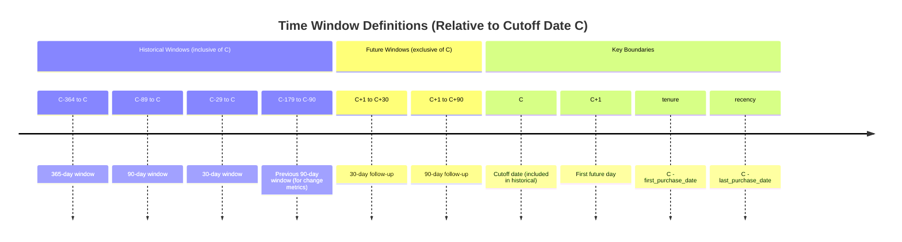

# Metric Specifications

This document defines every user-visible metric produced by the pipeline. Each metric includes its plain-English definition, exact formula, numerator, denominator, aggregation grain, included/excluded rows, time window and boundary rules, minimum-data requirements, and interpretation limitations.

## Conventions

- **Snapshot cutoff date (C)**: The analysis date. Historical windows include transactions on date C. Future windows begin on C+1.
- **Valid transaction**: A row passing all validation checks (required fields present, price ≥ 0, quantity > 0, all values finite).
- **Purchase event**: A unique `(customer_id, transaction_id, date)` combination after basket aggregation. Each basket represents one shopping occasion.
- **Line value**: Computed per `--price-mode`:
  - `unit`: `unit_price × quantity`
  - `line_total`: `price` (interpreted as line total)
- **Null semantics**: A metric is `null` (not zero) when its denominator is zero, required inputs are absent, or sample size is below the documented threshold.

## Time Window Definitions

All historical windows are **inclusive of C**. Future windows start at **C+1**. Change metrics (frequency_change, basket_change, spend_change) compare [C-89, C] vs [C-179, C-90] and require `tenure ≥ 179` (`comparable_windows = true`).

---

## Core Transaction Metrics

### spend
- **Definition**: Total monetary value of valid transactions in the window.
- **Formula**: `sum(line_value)`
- **Numerator**: Sum of line values for valid transactions in window
- **Denominator**: N/A (aggregate sum)
- **Grain**: Customer × window
- **Included rows**: Valid transactions with `transaction_date` in window
- **Excluded rows**: Rejected rows, transactions outside window
- **Window**: 30d, 90d, 365d, historical (all time up to C)
- **Boundary**: Historical windows include C; future windows start at C+1
- **Minimum data**: None (zero if no transactions)
- **Limitations**: Does not distinguish purchases from returns if returns exist in data

### purchases
- **Definition**: Count of distinct purchase events (baskets) in the window.
- **Formula**: `count(distinct (customer_id, transaction_id, date))`
- **Numerator**: Number of unique baskets
- **Denominator**: N/A
- **Grain**: Customer × window
- **Included rows**: Valid transactions aggregated to basket level
- **Excluded rows**: Rejected rows, transactions outside window
- **Window**: 30d, 90d, 365d, historical
- **Boundary**: Same as spend
- **Minimum data**: None
- **Limitations**: Assumes `transaction_id` uniquely identifies a basket per customer per day

### aov (Average Order Value)
- **Definition**: Mean basket value in the window.
- **Formula**: `spend / purchases`
- **Numerator**: `spend` in window
- **Denominator**: `purchases` in window
- **Grain**: Customer × window
- **Included rows**: Valid transactions in window
- **Excluded rows**: Rejected rows, transactions outside window
- **Window**: 365d (as `aov_365d`), 90d recent (`aov_recent`), 90d previous (`aov_previous`)
- **Boundary**: Same as spend
- **Minimum data**: `purchases > 0`; returns `null` if zero
- **Limitations**: Sensitive to basket definition; not a per-transaction metric

### median_basket
- **Definition**: Median basket value in the window.
- **Formula**: `median(basket_spend)` where `basket_spend = sum(line_value) per basket`
- **Numerator**: N/A (median of basket values)
- **Denominator**: N/A
- **Grain**: Customer × window
- **Included rows**: Valid transactions aggregated to basket level
- **Excluded rows**: Rejected rows, transactions outside window
- **Window**: 365d
- **Boundary**: Same as spend
- **Minimum data**: At least 1 basket; returns `null` if zero baskets
- **Limitations**: Median of potentially small sample

### basket_cv
- **Definition**: Coefficient of variation of basket values (std/mean).
- **Formula**: `std(basket_spend) / mean(basket_spend)`
- **Numerator**: Standard deviation of basket values
- **Denominator**: Mean of basket values
- **Grain**: Customer × window
- **Window**: 365d
- **Minimum data**: At least 2 baskets and mean > 0; returns `null` otherwise
- **Limitations**: Unstable for small samples

---

## Recency, Tenure, and Gap Metrics

### recency
- **Definition**: Days since last qualifying purchase as of cutoff C.
- **Formula**: `C - last_purchase_date` (in days)
- **Numerator**: N/A
- **Denominator**: N/A
- **Grain**: Customer × snapshot
- **Included rows**: Valid transactions with `date ≤ C`
- **Excluded rows**: Rejected rows, transactions after C
- **Window**: Historical (all time up to C)
- **Boundary**: Includes transactions on C
- **Minimum data**: At least 1 valid purchase; returns `null` if none
- **Limitations**: Does not account for censoring

### tenure
- **Definition**: Days since first qualifying purchase as of cutoff C.
- **Formula**: `C - first_purchase_date` (in days)
- **Numerator**: N/A
- **Denominator**: N/A
- **Grain**: Customer × snapshot
- **Included rows**: Valid transactions with `date ≤ C`
- **Excluded rows**: Rejected rows, transactions after C
- **Window**: Historical
- **Boundary**: Includes transactions on C
- **Minimum data**: At least 1 valid purchase; returns `null` if none
- **Limitations**: First observed purchase may not be true acquisition

### gap
- **Definition**: Days between consecutive qualifying purchase dates for the same customer.
- **Formula**: `purchase_date[i] - purchase_date[i-1]` for consecutive shopping days
- **Numerator**: N/A (per-gap value)
- **Denominator**: N/A
- **Grain**: Customer × gap (between shopping days)
- **Included rows**: Valid shopping days (baskets aggregated to day level)
- **Excluded rows**: Rejected rows, transactions after C
- **Window**: Historical up to C; gaps require both dates ≤ C
- **Boundary**: Both purchase dates must be ≤ C
- **Minimum data**: At least 2 shopping days to produce any gap
- **Limitations**: Shopping-day gaps, not transaction gaps

### gap_cv (Gap Coefficient of Variation)
- **Definition**: Variability of inter-purchase gaps relative to mean gap.
- **Formula**: `std(gaps) / mean(gaps)`
- **Numerator**: Standard deviation of gaps
- **Denominator**: Mean of gaps
- **Grain**: Customer × snapshot
- **Window**: 365d lookback with usability filter (gaps where prior date ≥ C-364)
- **Minimum data**: At least 2 gaps and mean gap > 0; returns `null` otherwise
- **Limitations**: Requires sufficient purchase frequency

### median_gap
- **Definition**: Median days between consecutive shopping days.
- **Formula**: `median(gaps)` with same usability filter as `gap_cv`
- **Grain**: Customer × snapshot
- **Window**: 365d lookback
- **Minimum data**: At least 1 gap; returns `null` otherwise

### lateness
- **Definition**: How overdue the customer is relative to their typical gap.
- **Formula**: `recency / median_gap`
- **Numerator**: `recency` (days since last purchase)
- **Denominator**: `median_gap` (typical inter-purchase interval)
- **Grain**: Customer × snapshot
- **Minimum data**: `median_gap > 0` and at least 1 purchase; returns `null` otherwise
- **Limitations**: Only meaningful for customers with established rhythm

---

## Breadth and Variety Metrics

### breadth (median_breadth)
- **Definition**: Median number of distinct categories per basket in the window.
- **Formula**: `median(distinct category_key per basket)` where `category_key = len(dept):dept + len(cat):cat`
- **Grain**: Customer × window
- **Window**: 365d
- **Minimum data**: At least 1 basket
- **Note**: Breadth measures category diversity, not product diversity. A basket with 3 products from 2 categories has breadth = 2.

### breadth_recent
- **Definition**: Mean distinct categories per basket in recent 90d window.
- **Formula**: `mean(distinct category_key per basket)` for baskets in last 90d
- **Grain**: Customer × snapshot
- **Window**: 90d
- **Minimum data**: At least 1 basket in window

### breadth_previous
- **Definition**: Mean distinct categories per basket in previous 90d window (days 91-180 before C).
- **Formula**: `mean(distinct category_key per basket)` for baskets in previous 90d
- **Grain**: Customer × snapshot
- **Window**: Previous 90d (C-179 to C-90)
- **Minimum data**: At least 1 basket in window

### products_last6days
- **Definition**: Distinct products purchased in the last 6 shopping days up to C.
- **Formula**: `count(distinct product_id)` over last 6 shopping days
- **Grain**: Customer × snapshot
- **Window**: Last 6 shopping days (not calendar days)
- **Minimum data**: At least 6 shopping days in history; returns `null` if fewer
- **Limitations**: Shopping-day count, not calendar days

### categories_last6days
- **Definition**: Distinct categories purchased in the last 6 shopping days.
- **Formula**: `count(distinct category_key)` over last 6 shopping days
- **Grain**: Customer × snapshot
- **Window**: Last 6 shopping days
- **Minimum data**: At least 6 shopping days; returns `null` if fewer

### category_count
- **Definition**: Number of distinct categories with at least 1 shopping day in 365d window.
- **Formula**: `count(distinct category)` where `year_days > 0`
- **Grain**: Customer × snapshot
- **Window**: 365d
- **Minimum data**: None (zero if no category activity)

### category_hhi (Herfindahl-Hirschman Index)
- **Definition**: Sum of squared category spend shares in 365d window.
- **Formula**: `sum((category_spend / total_spend)²)` for categories with spend > 0
- **Numerator**: Sum of squared shares
- **Denominator**: Implicit (shares sum to 1)
- **Grain**: Customer × snapshot
- **Window**: 365d
- **Minimum data**: `total_spend > 0` in 365d; returns `null` if zero spend
- **Range**: [1/N, 1] where N = number of categories; higher = more concentrated

### category_entropy (Shannon Entropy)
- **Definition**: Shannon entropy of category spend distribution (natural log).
- **Formula**: `-sum(p_i * ln(p_i))` where `p_i = category_spend / total_spend` for `p_i > 0`
- **Numerator**: N/A
- **Denominator**: N/A
- **Grain**: Customer × snapshot
- **Window**: 365d
- **Minimum data**: `total_spend > 0`; returns `null` if zero spend
- **Zero-probability handling**: Categories with zero spend contribute 0 to sum
- **Range**: [0, ln(N)]; higher = more diverse

### dominant_share
- **Definition**: Largest category spend share in 365d window.
- **Formula**: `max(category_spend / total_spend)`
- **Grain**: Customer × snapshot
- **Window**: 365d
- **Minimum data**: `total_spend > 0`; returns `null` if zero spend

### overdue_categories
- **Definition**: Count of categories where customer has ≥ 3 shopping days in all history and is overdue (lateness ≥ 2).
- **Formula**: `count(categories where days ≥ 3 and lateness ≥ 2)` where `days` = count of shopping days in all history for that category, and `lateness` = (C - last_category_purchase_date) / median_gap_for_category
- **Grain**: Customer × snapshot
- **Window**: Category history uses all history up to C; lateness uses all-history median gap
- **Minimum data**: Per-category: ≥ 3 shopping days in all history and median_gap > 0
- **Note**: This differs from `category_count` and `category_hhi` which are restricted to trailing 365d. The overdue check uses complete category history.

---

## Frequency and Rhythm Metrics

### days_history
- **Definition**: Total distinct shopping days in customer history up to C.
- **Formula**: `count(distinct date)` for customer
- **Grain**: Customer × snapshot
- **Window**: Historical

### days_365d
- **Definition**: Distinct shopping days in 365d window.
- **Formula**: `count(distinct date)` where `date ≥ C-364`
- **Grain**: Customer × snapshot
- **Window**: 365d

### gap_count
- **Definition**: Number of usable gaps in 365d window.
- **Formula**: `count(gaps where prior_date ≥ C-364)`
- **Grain**: Customer × snapshot
- **Window**: 365d with usability filter
- **Minimum data**: None (zero if insufficient history)

### product_overlap
- **Definition**: Median Jaccard similarity of product sets between consecutive shopping days.
- **Formula**: `median(|products_t ∩ products_t-1| / |products_t ∪ products_t-1|)` for usable gaps
- **Grain**: Customer × snapshot
- **Window**: 365d with usability filter
- **Minimum data**: At least 1 usable gap; returns `null` otherwise

### category_overlap
- **Definition**: Median Jaccard similarity of category sets between consecutive shopping days.
- **Formula**: `median(|categories_t ∩ categories_t-1| / |categories_t ∪ categories_t-1|)` for usable gaps
- **Grain**: Customer × snapshot
- **Window**: 365d with usability filter
- **Minimum data**: At least 1 usable gap; returns `null` otherwise

### weekend_share
- **Definition**: Proportion of shopping days falling on weekend (Saturday/Sunday) in 365d window.
- **Formula**: `count(shopping_days where weekday ≥ 6) / count(shopping_days in 365d)`
- **Numerator**: Weekend shopping days
- **Denominator**: Total shopping days in 365d
- **Grain**: Customer × snapshot
- **Window**: 365d
- **Minimum data**: At least 1 shopping day in 365d; returns `null` if zero

### personal_spend_ratio
- **Definition**: Median ratio of day spend to rolling 5-day median baseline spend in recent 90d.
- **Formula**: `median(day_spend / baseline_spend)` for recent 90d where baseline exists
- **Grain**: Customer × snapshot
- **Window**: Recent 90d
- **Minimum data**: At least 3 shopping days for baseline calculation

### reactivation_events
- **Definition**: Count of shopping days in recent 30d where gap ≥ 2 × baseline_gap.
- **Formula**: `sum(1 for days in last 30d where gap ≥ 2 × baseline_gap)`
- **Grain**: Customer × snapshot
- **Window**: Recent 30d
- **Minimum data**: Baseline gap requires 5-day rolling median with min_samples=3

### weekday_entropy
- **Definition**: Shannon entropy of weekday purchase distribution in 365d (natural log).
- **Formula**: `-sum(p_w * ln(p_w))` where `p_w = count(weekday w) / total_shopping_days_365d`
- **Grain**: Customer × snapshot
- **Window**: 365d
- **Minimum data**: At least 1 shopping day in 365d; returns `null` if zero
- **Zero-probability handling**: Weekdays with zero purchases contribute 0

---

## Trial and Repeat Metrics

### eligible_trials
- **Definition**: Products first purchased in the eligible trial window [C-364, C-90].
- **Formula**: `count(distinct products where trial_date ∈ [C-364, C-90])`
- **Grain**: Customer × snapshot
- **Window**: Trial date must be in [C-364, C-90] (inclusive on both ends)
- **Minimum data**: None (zero if no eligible trials)

### repeated_trials
- **Definition**: Eligible trials with a repeat purchase within 90 days of trial.
- **Formula**: `count(eligible_trials where repeat_date ≤ trial_date + 90d)`
- **Grain**: Customer × snapshot
- **Window**: Trial in [C-364, C-90], repeat within 90d of trial (and ≤ C)
- **Minimum data**: None (zero if no eligible trials)

### trial_conversion
- **Definition**: Proportion of eligible trials that repeated within 90 days.
- **Formula**: `repeated_trials / eligible_trials`
- **Numerator**: `repeated_trials`
- **Denominator**: `eligible_trials`
- **Grain**: Customer × snapshot
- **Minimum data**: `eligible_trials > 0`; returns `null` if zero

### core_size
- **Definition**: Count of products purchased on ≥ 3 distinct days in the customer's entire history up to cutoff C.
- **Formula**: `count(products where purchase_days ≥ 3)` where `purchase_days` = count of distinct purchase dates for that product across all history.
- **Grain**: Customer × snapshot
- **Window**: All history up to C
- **Minimum data**: None
- **Note**: Eligibility is based on complete history, not restricted to trailing 365d. Spend attribution for core products is restricted to trailing 365d (see `core_spend`).

### core_spend
- **Definition**: Total spend on core products (products with ≥ 3 purchase days in all history) in the trailing 365d window.
- **Formula**: `sum(spend for products where purchase_days ≥ 3)` for transactions in [C-364, C]
- **Grain**: Customer × snapshot
- **Window**: Core eligibility uses all history; spend attribution uses trailing 365d
- **Minimum data**: None

### core_spend_share
- **Definition**: Proportion of 365d spend attributable to core products.
- **Formula**: `core_spend / spend_365d`
- **Numerator**: `core_spend`
- **Denominator**: `spend_365d`
- **Grain**: Customer × snapshot
- **Minimum data**: `spend_365d > 0`; returns `null` if zero

### new_share
- **Definition**: Mean fraction of distinct products per basket that are first-time purchases (prior_days = 0) across all baskets in 365d window.
- **Formula**: For each basket: `(count of products with prior_days=0) / (total distinct products in basket)`. Then `mean` across all baskets in 365d.
- **Grain**: Customer × snapshot
- **Window**: 365d
- **Minimum data**: At least 1 basket in 365d; returns `null` if zero
- **Note**: This is a basket-weighted mean of product fractions, NOT the proportion of baskets containing any new product. A basket with 3 products where 1 is new contributes 1/3 to the mean.

### repeat_share
- **Definition**: Mean fraction of distinct products per basket that are repeat purchases (prior_days ≥ 1) across all baskets in 365d window.
- **Formula**: For each basket: `(count of products with prior_days ≥ 1) / (total distinct products in basket)`. Then `mean` across all baskets in 365d.
- **Grain**: Customer × snapshot
- **Window**: 365d
- **Minimum data**: At least 1 basket in 365d; returns `null` if zero
- **Note**: Established products (prior_days ≥ 2) are a subset of repeated products. A basket with 1 new and 2 established products has repeat_share = 2/3 and established_share = 2/3.

### established_share
- **Definition**: Mean fraction of distinct products per basket that are established (prior_days ≥ 2) across all baskets in 365d window.
- **Formula**: For each basket: `(count of products with prior_days ≥ 2) / (total distinct products in basket)`. Then `mean` across all baskets in 365d.
- **Grain**: Customer × snapshot
- **Window**: 365d
- **Minimum data**: At least 1 basket in 365d; returns `null` if zero

---

## Price Features

### relative_paid_price
- **Definition**: Median ratio of paid unit_price to reference median unit_price (per product) for comparable lines.
- **Formula**: `median(unit_price / reference_price)` for lines where `reference_count ≥ 5`
- **Grain**: Customer × snapshot
- **Window**: 365d
- **Minimum data**: At least 1 comparable line (reference_count ≥ 5); returns `null` otherwise
- **Reference price**: Median unit_price per product from all customers in [C-364, C]

### comparable_price_lines
- **Definition**: Count of transaction lines in 365d with sufficient reference data (reference_count ≥ 5).
- **Formula**: `count(lines in 365d where reference_count ≥ 5)`
- **Grain**: Customer × snapshot
- **Window**: 365d

---

## Derived Change Metrics

### frequency_change
- **Definition**: Relative change in purchase frequency: recent 90d vs previous 90d.
- **Formula**: `purchases_90d / purchases_previous90d - 1`
- **Numerator**: `purchases_90d`
- **Denominator**: `purchases_previous90d`
- **Grain**: Customer × snapshot
- **Condition**: Only computed when `comparable_windows = True` (tenure ≥ 179 days)
- **Minimum data**: `purchases_previous90d > 0` and comparable windows; returns `null` otherwise

### basket_change
- **Definition**: Relative change in AOV: recent 90d vs previous 90d.
- **Formula**: `aov_recent / aov_previous - 1`
- **Condition**: Only when `comparable_windows = True`
- **Minimum data**: Both AOVs defined and `aov_previous > 0`; returns `null` otherwise

### spend_change
- **Definition**: Relative change in spend: recent 90d vs previous 90d.
- **Formula**: `spend_90d / spend_previous90d - 1`
- **Condition**: Only when `comparable_windows = True`
- **Minimum data**: `spend_previous90d > 0` and comparable windows; returns `null` otherwise

### breadth_change
- **Definition**: Absolute change in mean breadth: recent 90d minus previous 90d.
- **Formula**: `breadth_recent - breadth_previous`
- **Grain**: Customer × snapshot
- **Minimum data**: Both breadth values defined; returns `null` otherwise

---

## Future Follow-up Metrics (Post-Cutoff)

### future_purchases_{30,90}d
- **Definition**: Count of distinct purchase events in (C, C+{30,90}].
- **Formula**: `count(distinct (customer_id, transaction_id, date))` for `C < date ≤ C+{30,90}`
- **Grain**: Customer × snapshot
- **Window**: Post-cutoff, exclusive of C, inclusive of C+{30,90}
- **Condition**: Only populated when `coverage_confirmed = True` AND `C+{30,90} ≤ observed_through`
- **Otherwise**: `null`
- **Minimum data**: None (zero if no future purchases, but only when eligible)

### future_spend_{30,90}d
- **Definition**: Total spend in (C, C+{30,90}].
- **Formula**: `sum(line_value)` for `C < date ≤ C+{30,90}`
- **Grain**: Customer × snapshot
- **Window**: Post-cutoff, exclusive of C, inclusive of C+{30,90}
- **Condition**: Same as future_purchases
- **Otherwise**: `null`

### eligible_followup_{30,90}d
- **Definition**: Boolean flag indicating whether future follow-up window is fully observed.
- **Formula**: `coverage_confirmed AND (C + {30,90} ≤ observed_through)`
- **Grain**: Customer × snapshot (same for all customers at a snapshot)

---

## Segmentation Thresholds (Quantile-Based)

### value_low, value_high
- **Definition**: 33rd and 80th percentiles of `spend_90d` for customers with `tenure ≥ 89` and `spend_90d > 0` at reference snapshot.
- **Population**: Customers at first snapshot meeting tenure and spend criteria
- **Used for**: `value_tier` assignment

### basket_low, basket_high
- **Definition**: 33rd and 80th percentiles of `median_basket` for customers with `days_365d ≥ 6`, `tenure ≥ 90`, `gap_count ≥ 4` at reference snapshot.
- **Population**: Style-eligible customers at first snapshot

### gap_low, gap_high
- **Definition**: 33rd and 80th percentiles of `median_gap` for same population as basket thresholds.
- **Population**: Style-eligible customers at first snapshot

---

## Behavioral Style Tags (Multiple Can Apply; Ordered)

All style tags require `style_eligible = True`:
- `days_365d ≥ 6` AND `tenure ≥ 90` AND `gap_count ≥ 4`

Tags are evaluated in the following order and ALL matching tags are collected:
1. **routine_repeat**: `gap_cv ≤ 0.75` AND `established_share ≥ 0.70`
2. **focused_repeat**: `dominant_share ≥ 0.70` AND `established_share ≥ 0.70`
3. **broad_repeat**: `median_breadth ≥ 3` AND `established_share ≥ 0.70`
4. **exploration_heavy**: `new_share ≥ 0.40`
5. **large_basket_episodic**: `median_basket ≥ basket_high` AND `median_gap ≥ gap_high` (requires thresholds)
6. **small_basket_frequent**: `median_basket ≤ basket_low` AND `median_gap ≤ gap_low` (requires thresholds)

**Important**: These tags are NOT mutually exclusive. A customer can match multiple tags simultaneously. The `behavioral_tags` field contains a list of all matching tags in the order above. The `behavior` field joins them with "+" (e.g., "routine_repeat+focused_repeat"). Customers eligible but matching no tag → `mixed_other`. Customers not eligible → `insufficient_history`.

---

## Trajectory Tags (Multiple Can Apply)

- **slowing**: `frequency_change ≤ -0.25`
- **smaller_baskets**: `basket_change ≤ -0.25`
- **narrowing**: `comparable_windows AND (breadth_change ≤ -0.5 OR overdue_categories ≥ 2)`
- **broad_decline**: `slowing AND smaller_baskets`
- **expanding**: `frequency_change ≥ 0.25 OR basket_change ≥ 0.25`
- **overdue**: `style_eligible AND lateness ≥ 2`
- **reactivated**: `reactivation_events > 0`
- **stable**: `style_eligible AND comparable_windows AND frequency_change not null AND none of (slowing, smaller_baskets, narrowing, expanding, overdue, reactivated)`

Precedence: Tags are collected as a list; `not_classified` if no tags apply.

---

## Lifecycle Stages (Mutually Exclusive)

1. **first_observed**: `days_history == 1` AND `tenure < 90`
2. **one_shopping_day**: `days_history == 1` AND `tenure ≥ 90`
3. **established_repeat**: `days_history ≥ 6` AND `tenure ≥ 90`
4. **early_repeat**: All other cases

---

## Evidence Levels (Mutually Exclusive)

1. **stronger**: `style_eligible AND gap_count ≥ 12`
2. **limited**: `style_eligible` (but gap_count < 12)
3. **insufficient**: Not `style_eligible`

---

## Value Tiers (Mutually Exclusive, Requires Thresholds)

1. **insufficient_exposure**: `tenure < 89`
2. **no_recent_spend**: `spend_90d == 0` (or null)
3. **high**: `spend_90d ≥ value_high`
4. **low**: `spend_90d ≤ value_low`
5. **middle**: Otherwise
6. **reference_unavailable**: If thresholds not computed

---

## Segment Profile Metrics (Per Snapshot × Behavior)

- **customers**: Count of customers in segment
- **revenue**: Sum of `spend_90d` for segment
- **median_spend**: Median `spend_90d` for segment
- **median_gap**: Median `median_gap` for segment
- **exploration**: Mean `new_share` for segment
- **mean_customer_trial_conversion**: Mean `trial_conversion` for segment (null-excluding mean)
- **future_purchase_rate_{30,90}d**: Proportion with `future_purchases > 0` among `eligible_followup` customers
- **future_mean_spend_{30,90}d**: Mean `future_spend` among `eligible_followup` customers
- **eligible_customers_{30,90}d**: Count of `eligible_followup` customers
- **customer_share**: `customers / total_customers_at_snapshot`
- **revenue_share**: `revenue / total_revenue_at_snapshot`

---

## Cohort Profile Metrics (Per Snapshot × First-Purchase Month)

- **cohort**: First purchase month (truncated to month start)
- **customers**: Customers in cohort at snapshot
- **mean_cumulative_spend**: Mean `spend_history` (all time up to snapshot)
- **rolling30d_purchase_rate**: Proportion with `purchases_30d > 0`
- **future30d_purchase_rate**: Proportion with `future_purchases_30d > 0` among eligible (null if not eligible)

**Critical limitation**: Cohorts have unequal observation windows. A cohort first observed 1 month before snapshot has far less opportunity to repurchase than one observed 12 months prior. Raw rates are not comparable without exposure adjustment.

---

## Segment Transition Metrics

- **from_date**: Previous snapshot date
- **snapshot**: Current snapshot date
- **dimension**: One of `behavior`, `trajectory`, `lifecycle`, `value_tier`
- **from_label**: Label at previous snapshot
- **to_label**: Label at current snapshot
- **customers**: Count transitioning
- **eligible_origin**: Total customers with `from_label` at `from_date`
- **transition_rate**: `customers / eligible_origin`

---

## Data Quality Metrics (quality.json)

- **source_rows**: Total rows in input
- **rejected_rows**: Rows failing validation
- **first_date**: Minimum valid transaction date
- **last_date**: Maximum valid transaction date
- **observed_through**: Effective analysis end date
- **coverage_confirmed**: Boolean from CLI
- **coverage_interpretation**: Explanatory text
- **preserved_duplicate_extras**: Count of duplicate rows beyond first per unique key

### Validation Rules (Row Rejected If Any True)
1. Any required field null: `customer_id`, `transaction_id`, `product_id`, `date`
2. `price` not finite OR `price < 0`
3. `quantity` not finite OR `quantity ≤ 0`
4. Computed `value` not finite
5. Date parse failure (becomes null, caught by rule 1)

### Rejected Row Output (rejected.parquet)
All original columns plus:
- `date`: Parsed date (null if parse failed)
- `value`: Computed value (null if computation failed)
- `rejection_reason`: Primary rejection reason code

Rejection reason codes:
- `missing_customer_id`, `missing_transaction_id`, `missing_product_id`: Required field null/empty
- `invalid_date`: Date parse failure
- `null_price`, `null_quantity`: Numeric field null (missing in source)
- `malformed_price`, `malformed_quantity`: Non-numeric token that failed conversion
- `nonfinite_price`, `nonfinite_quantity`: NaN or infinity
- `negative_price`: Price < 0
- `nonpositive_quantity`: Quantity ≤ 0
- `nonfinite_value`: Computed value not finite

**Note**: The `valid` column is NOT included (dropped before write). Each row has exactly one primary reason; multiple issues on the same row are not enumerated. Missing source values and malformed tokens both become null after casting but are tracked separately in quality.json counters.

---

## Known Limitations

1. **No return/refund handling**: All valid rows treated as purchases. Negative quantities rejected. Net revenue not computed.
2. **Relative segmentation**: Quantile thresholds depend on snapshot population; labels not portable across snapshots.
3. **Cohort immaturity**: Cohort metrics not adjusted for observation window length.
4. **Basket definition**: Assumes `(customer_id, transaction_id, date)` uniquely identifies a basket. Conflicts raise error.
5. **No causal claims**: All associations descriptive. Segment differences ≠ intervention effects.
6. **Future outcomes require coverage_confirmed**: Without explicit confirmation, future metrics are null.
7. **Currency**: Amounts in input data's currency; no conversion or symbol assumed.
8. **Timezone**: Datetimes converted to date; time component discarded. No timezone handling.