# Polars Customer Behavior Analytics

A customer behavior analytics pipeline built with [Polars](https://pola.rs) for retail transaction data.

## Data Workflow

```mermaid
flowchart TD
    %% =============================================
    %% HIGH-LEVEL DATA PIPELINE
    %% =============================================
    
    subgraph INPUT["INPUT"]
        SRC["customer_transactions.parquet\n(2.6M rows x 9 cols)"]
    end

    subgraph PREP["PREPARATION & VALIDATION"]
        SCAN["Scan & Validate Schema"]
        PARSE["Parse Dates\n(String/Datetime to Date)"]
        CLEAN["Clean & Cast Types\n(Strip, null handling, Float64)"]
        VALUE["Compute Value\n(unit: price x qty or line_total: price)"]
        VALIDATE["Row Validation\n(Required fields, price>=0, qty>0, finite)"]
        AUDIT["Quality Audit\nto quality.json"]
        REJECT["Rejected Rows\nto rejected.parquet"]
        ENRICH["Enrich\n(unit_price, category_key, bucket)"]
        PARTITION["Partition by Bucket\nto partitions/bN.parquet"]
        CHECKS["Integrity Checks\n- Basket conflicts\n- Product variation"]
    end

    subgraph SNAPSHOT["SNAPSHOT GENERATION (per cutoff date)"]
        PRICE_REF["Price References\n(Median unit_price per product)"]
        BASKETS["Basket Aggregation\n(customer_id, txn_id, date)\nto spend, products, breadth"]
        BASE["Customer Base Features\n- History: first/last purchase\n- Counts: purchases_30d, 90d, 365d\n- Spend: spend_30d, 90d, 365d\n- AOV, median_basket, breadth"]
        DAILY["Daily Features\n- day_spend, products list, categories list\n- gap, relative_spend\n- Jaccard overlap (products/categories)"]
        RHYTHM["Rhythm Features\n- median_gap, gap_cv\n- product/category overlap\n- weekend_share, reactivation_events"]
        WEEKDAY["Weekday Entropy"]
        BREADTH["Last 6 Days Breadth"]
        PROD["Product-Level Features\n- trial/repeat dates\n- prior_days, next_gap\n- relative_qty"]
        TRIALS["Trial Conversion\n- eligible_trials, repeated_trials\n- core_size, core_spend"]
        CAT["Category History\n- share, HHI, entropy\n- dominant category\n- overdue_categories"]
        PRICE_FEAT["Price Features\n- relative_paid_price\n- comparable_price_lines"]
        MERGE["Merge All Features\nto 78 columns"]
        DERIVED["Derived Metrics\n- tenure, recency\n- aov_recent/previous\n- frequency/basket/spend_change\n- lateness, breadth_change"]
        FOLLOWUP["Future Followup (no lookahead)\n- future_purchases_30d, 90d\n- future_spend_30d, 90d"]
    end

    subgraph LABEL["LABELING & CLASSIFICATION"]
        THRESH["Quantile Thresholds\n(value/basket/gap low/high)"]
        STYLE["Behavioral Style Tags\n- routine_repeat (gap_cv<=.75, repeat>=.7)\n- focused_repeat (dominant>=.7, repeat>=.7)\n- broad_repeat (breadth>=3, repeat>=.7)\n- exploration_heavy (new_share>=.4)"]
        TRAJ["Trajectory Tags\n- slowing / smaller_baskets\n- narrowing / broad_decline\n- expanding / overdue / reactivated / stable"]
        LIFECYCLE["Lifecycle\n- first_observed / long_observed_single\n- early_repeat / established_repeat"]
        EVIDENCE["Evidence Level\n- stronger / limited / insufficient"]
        BEHAVIOR["Behavior Label"]
        TRAJ_L["Trajectory Label"]
        VALUE_TIER["Value Tier\n- high / middle / low\n- insufficient_exposure / no_recent_spend"]
    end

    subgraph REPORTS["REPORTING"]
        SEG["Segment Profiles\n(customers, revenue, rates by behavior)"]
        COHORT["Cohort Profiles\n(mean spend, purchase rates by cohort)"]
        TRANS["Segment Transitions\n(transition rates by dimension)"]
    end

    %% Connections
    SRC --> SCAN --> PARSE --> CLEAN --> VALUE --> VALIDATE --> AUDIT
    AUDIT --> REJECT
    AUDIT --> ENRICH --> PARTITION --> CHECKS
    
    CHECKS --> PRICE_REF
    CHECKS --> BASKETS
    BASKETS --> BASE
    BASE --> DAILY --> RHYTHM
    DAILY --> WEEKDAY
    DAILY --> BREADTH
    DAILY --> PROD --> TRIALS
    PROD --> CAT
    BASE -.-> PRICE_FEAT
    PRICE_REF -.-> PRICE_FEAT
    
    BASE --> MERGE
    RHYTHM --> MERGE
    WEEKDAY --> MERGE
    BREADTH --> MERGE
    TRIALS --> MERGE
    CAT --> MERGE
    PRICE_FEAT --> MERGE
    
    MERGE --> DERIVED --> FOLLOWUP
    
    FOLLOWUP --> THRESH --> STYLE --> TRAJ --> LIFECYCLE --> EVIDENCE --> BEHAVIOR --> TRAJ_L --> VALUE_TIER
    
    VALUE_TIER --> SEG
    VALUE_TIER --> COHORT
    VALUE_TIER --> TRANS

    %% Styling
    classDef input fill:#e3f2fd,stroke:#1565c0,stroke-width:2px
    classDef prep fill:#fff3e0,stroke:#ef6c00,stroke-width:2px
    classDef snap fill:#e8f5e9,stroke:#2e7d32,stroke-width:2px
    classDef label fill:#fce4ec,stroke:#c2185b,stroke-width:2px
    classDef report fill:#f3e5f5,stroke:#7b1fa2,stroke-width:2px
    
    class SRC input
    class SCAN,PARSE,CLEAN,VALUE,VALIDATE,AUDIT,REJECT,ENRICH,PARTITION,CHECKS prep
    class PRICE_REF,BASKETS,BASE,DAILY,RHYTHM,WEEKDAY,BREADTH,PROD,TRIALS,CAT,PRICE_FEAT,MERGE,DERIVED,FOLLOWUP snap
    class THRESH,STYLE,TRAJ,LIFECYCLE,EVIDENCE,BEHAVIOR,TRAJ_L,VALUE_TIER label
    class SEG,COHORT,TRANS report
```



## Quick Start

```bash
# Install dependencies
pip install polars

# Run pipeline
python retail_polars_workflow.py \
  --input customer_transactions.parquet \
  --output results \
  --price-mode unit \
  --snapshots 2000-06-30 2001-06-30 2001-12-11 \
  --buckets 4 \
  --exclude-invalid
```

## Outputs

| File | Description |
|------|-------------|
| `results/quality.json` | Data quality audit |
| `results/validated.parquet` | Cleaned transactions |
| `results/snapshots/{date}/b{N}.parquet` | Customer features (78 cols) with labels |
| `results/segment_profiles.parquet` | Segment metrics per cutoff |
| `results/segment_transitions.parquet` | Transition rates between segments |
| `results/cohort_profiles.parquet` | Cohort analysis by first purchase month |

## Tests

```bash
python -m unittest test_retail_polars_workflow -v
```